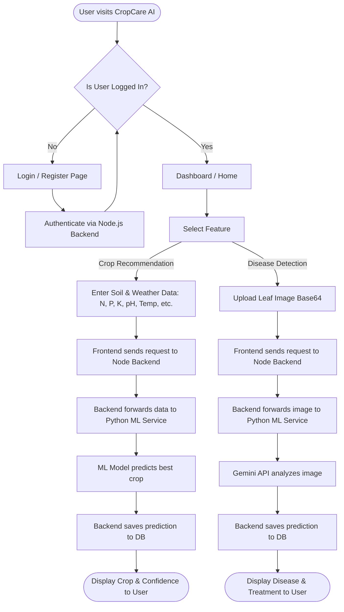
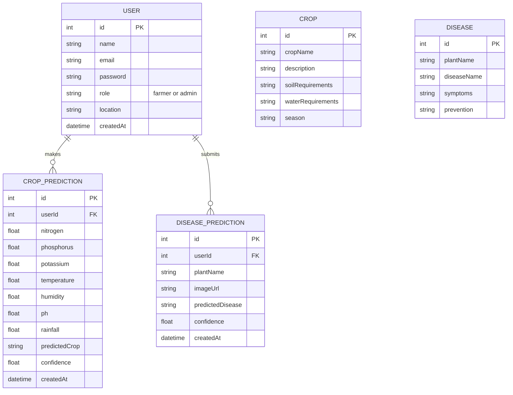

# CropCare AI - Project Walkthrough & Synopsis

## 1. Introduction
**CropCare AI** is a comprehensive agricultural assistant designed to help farmers make data-driven decisions. The platform leverages Machine Learning (ML) to provide personalized crop recommendations based on soil metrics and environmental conditions, and uses advanced Generative AI to detect plant diseases from leaf images. It consists of a modern web interface, a robust backend API, and a dedicated microservice for ML predictions.

## 2. Technology Stack
- **Frontend**: React.js, Vite, React Router, custom CSS for UI, `lucide-react` for icons, `react-hot-toast` for notifications.
- **Backend**: Node.js, Express.js, Prisma ORM, SQLite (dev) / PostgreSQL (prod).
- **Machine Learning Service**: Python, FastAPI, scikit-learn (Random Forest), TensorFlow, Google Gemini API for disease analysis.
- **Authentication**: JSON Web Tokens (JWT) & bcryptjs.

## 3. Core Features Developed
1. **User Authentication & Authorization**: Secure login, registration, and role-based access control (Farmers vs. Admins).
2. **Crop Recommendation Engine**: Analyzes NPK (Nitrogen, Phosphorus, Potassium), pH, temperature, humidity, and rainfall to recommend the most suitable crop (using an ML model with heuristic fallbacks).
3. **Plant Disease Detection**: Users can upload a photo of a sick plant leaf. The system identifies the plant, detects the disease, and returns a confidence score along with actionable treatment suggestions.
4. **User Dashboard**: A personalized dashboard for farmers to track their past predictions and historical data.

---

## 4. System Flowchart

The flowchart below illustrates how a user interacts with the system, specifically detailing the paths for Crop Recommendation and Disease Detection.

---

## 5. Entity Relationship (ER) Diagram

The ER diagram illustrates the database architecture built with Prisma ORM.

---

## 6. Architecture Overview
The system is built on a microservices-inspired architecture:
1. **Frontend App**: Communicates exclusively with the Node.js backend.
2. **Node.js Backend**: Acts as an API Gateway and handles business logic, database transactions, and user authentication.
3. **Python ML Service**: An isolated, compute-heavy FastAPI service that runs the scikit-learn random forest models and interfaces with the Gemini AI model. The Node.js backend communicates with this service via internal HTTP requests.
